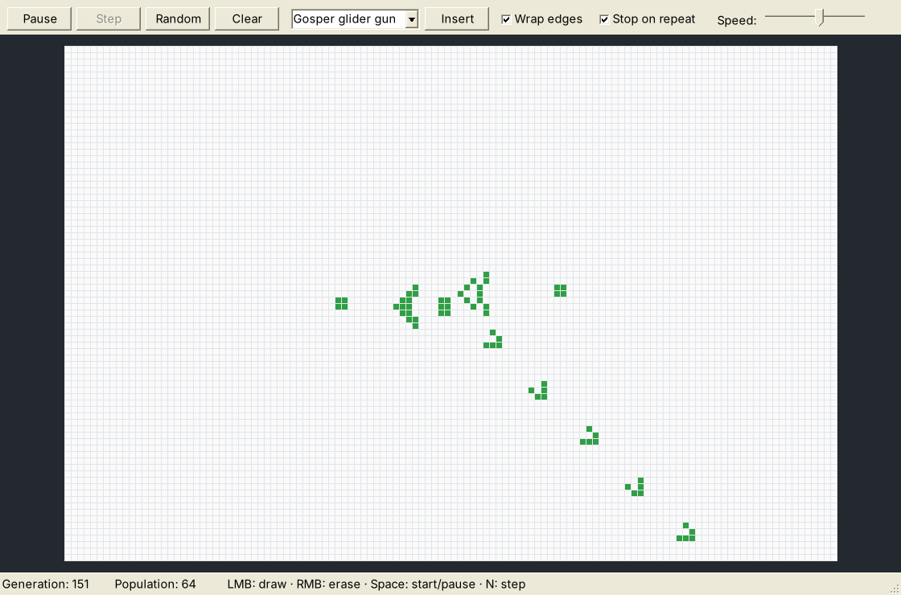

# Game of Life

Реализация клеточного автомата Джона Конвея «Жизнь»: графическая версия для Windows (C#, WinForms)
и консольная версия на Python.



## Скачать

Готовый **`GameOfLife.exe`** лежит в [Releases](https://github.com/flew96/life-game/releases/latest).
Скачайте и запустите — нужен только Windows 10 или 11 (.NET Framework 4.7.2+ там уже есть).

> Программа не подписана, поэтому SmartScreen может показать предупреждение:
> «Подробнее» → «Выполнить в любом случае».

## Возможности

- **Рисование мышью прямо на поле:** левая кнопка — оживить клетки, правая — стереть (можно вести с зажатой кнопкой).
- **Готовые фигуры:** глайдер, лёгкий космический корабль, мигалка, пульсар, пентадекатлон,
  ружьё Госпера, R-пентамино, «Желудь», Diehard — вставляются в центр поля.
- **Управление:** старт/пауза, один шаг, случайное заполнение, очистка, регулировка скорости.
- **Замкнутые края (тор)** — включаются и выключаются галочкой «Wrap edges».
- **Определение конца игры:** вымирание, стабильная конфигурация или цикл (с указанием периода).
  С галочкой «Stop on repeat» симуляция при этом ставится на паузу.
- Счётчики поколения и популяции, поле масштабируется под размер окна.

### Горячие клавиши

| Клавиша | Действие |
| --- | --- |
| `Space` | старт / пауза |
| `N` | одно поколение |
| `R` | случайное поле |
| `C` | очистить поле |
| `I` | вставить выбранную фигуру |
| `Esc` | пауза |

## Консольная версия (Python)

Нужен Python 3.7+, сторонние библиотеки не требуются.

```bash
python game_of_life_console.py
```

Без аргументов программа спросит размеры поля, скорость и способ заполнения. Можно задать всё сразу:

```bash
python game_of_life_console.py --rows 20 --cols 40 --speed fast --seed 42
```

Опции: `--rows`, `--cols`, `--speed {fast,normal,slow,step}`, `--manual` (ввод клеток вручную),
`--density`, `--no-wrap`, `--generations`, `--seed`. Полный список — `--help`.

## Сборка из исходников

Нужен [.NET SDK 8](https://dotnet.microsoft.com/download) (Windows, Linux или macOS) либо Visual Studio 2022.

```bash
dotnet build src/GameOfLife -c Release
```

Готовый файл: `src/GameOfLife/bin/Release/net472/GameOfLife.exe`. В Visual Studio откройте `GameOfLife.sln`.

Тесты логики игры (запускаются на любой ОС):

```bash
dotnet test tests/GameOfLife.Tests
```

### Выпуск новой версии

Сборка и тесты запускаются GitHub Actions на каждый push и pull request.
Чтобы опубликовать релиз с exe-файлом, достаточно отправить тег вида `vX.Y.Z`:

```bash
git tag v2.0.1
```

```bash
git push origin v2.0.1
```

## Структура проекта

```
src/GameOfLife/
  LifeEngine.cs   логика игры (без UI): правила B3/S23, тор, поиск циклов
  Pattern.cs      фигуры и их текстовое описание
  GridView.cs     отрисовка поля и рисование мышью
  MainForm.cs     главное окно, панель управления, горячие клавиши
  Program.cs      точка входа
tests/GameOfLife.Tests/   unit-тесты движка (xUnit)
game_of_life_console.py   консольная версия
```

## Лицензия

MIT — см. [LICENSE](LICENSE).
